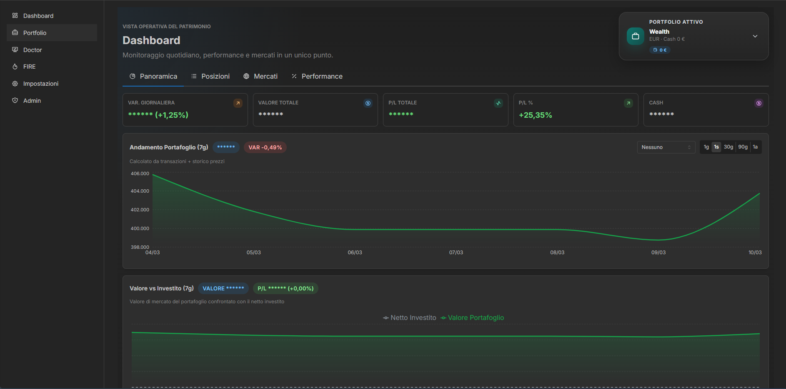
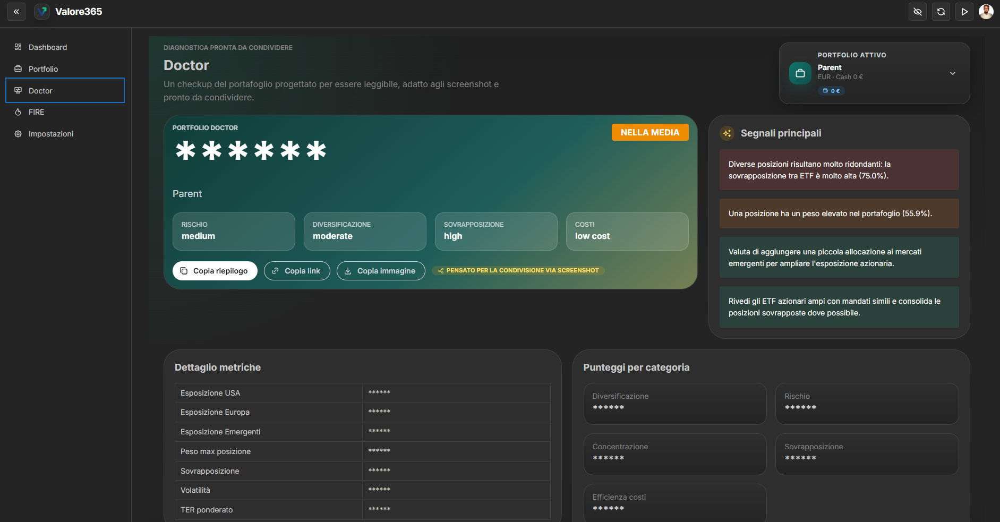
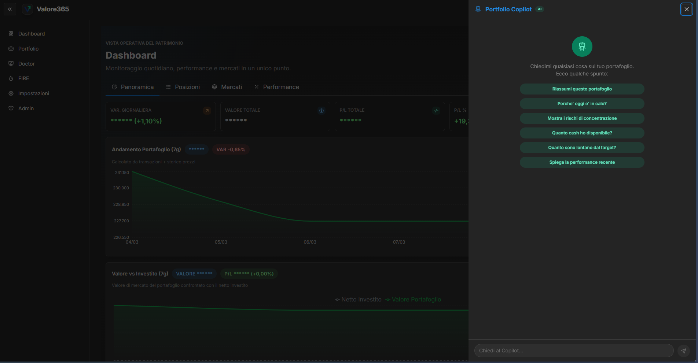

 
#  Valore365


[](#-ai-ready-mcp)

## 🧠 Capisci se il tuo portafoglio è davvero ben costruito

Valore365 è una piattaforma di **portfolio intelligence** pensata per investitori italiani che vogliono **analizzare, comprendere e migliorare il proprio portafoglio**.

A differenza dei normali portfolio tracker, Valore365 si concentra sulla **struttura del portafoglio**:

- 🌍 diversificazione geografica  
- 📊 concentrazione degli asset  
- 🔁 sovrapposizione tra ETF  
- ⚠️ rischio complessivo  

---

# ⚡ Demo

Puoi provare l'analisi del portafoglio **senza registrazione**.
https://valore365.vercel.app

### 🧾 Input esempio


VWCE 10000
AGGH 5000
EIMI 2000


### 📊 Output


Portfolio Score: 74

⚠️ Esposizione USA elevata
⚠️ Sovrapposizione ETF
💡 Migliora la diversificazione


---

# 🩺 Portfolio Doctor

Il **Portfolio Doctor** analizza automaticamente il portafoglio e produce una diagnosi.

### 📋 Esempio


Portfolio Score: 74 / 100

📉 Rischio: medio
🌍 Diversificazione: buona
💰 Costi: bassi

⚠️ Avvisi

Esposizione USA elevata

Sovrapposizione ETF


L'analisi è **deterministica e basata su regole**, per garantire risultati coerenti.

## Doctor 2.0

Il Doctor ora affianca alla diagnosi standard i **tuoi parametri**:

- **I miei parametri**: regole personali per portafoglio o vista aggregata (es. «nessun ETF oltre il 35%»), verificate in modo deterministico con esito *rispettato / violato / non verificabile*, evidenze e storico versioni. Separate dal punteggio Doctor, che non cambia.
- **Copilot assistito**: propone bozze di parametri con anteprima; nulla viene salvato senza la tua conferma.
- **Laboratorio**: confronta fino a 3 scenari ipotetici con il portafoglio attuale. Simulazione teorica; nessun ordine eseguito.

Documentazione in [docs/doctor2/](docs/doctor2/): [contratti API](docs/doctor2/api-contracts.md), [architettura](docs/doctor2/architecture.md), [metodologia finanziaria](docs/doctor2/financial-methodology.md), [specifica UI](docs/doctor2/ui-spec.md), [decisioni aperte](docs/doctor2/open-decisions.md).

Feature flag backend (default `true`; se `false` gli endpoint rispondono 404 `feature_disabled` e la sezione sparisce dalla UI):

| variabile | controlla |
|---|---|
| `DOCTOR_POLICY_ENABLED` | I miei parametri (policy ed evaluation) e i tool Copilot sulle policy |
| `DOCTOR_SIMULATOR_ENABLED` | Laboratorio (Scenario Lab) e i tool Copilot sugli scenari |

## ⚖️ Tribunale del portafoglio

Una sezione del Doctor in cui **tre voci AI con filosofie d'investimento diverse** discutono lo stesso portafoglio: *L'indicizzatore* (basso costo, ampia diversificazione, semplicità), *Il fattoriale* (inclinazioni volute, concentrazione consapevole) e *Il prudente* (protezione del capitale, reddito, tenuta nei ribassi). **Il Doctor calcola, l'AI interpreta.**

- **Fascicolo**: prima della seduta il Doctor raccoglie fino a 40 fatti deterministici (composizione, concentrazione, costi, salute, X-Ray, stress test, Monte Carlo, i tuoi parametri), ciascuno con valore, fonte e qualità del dato. Nessun LLM li produce.
- **Seduta**: apertura (le tre voci in parallelo) → replica (ogni voce risponde alle altre) → sintesi (punti condivisi, punti contesi, domande aperte per te). Mai un vincitore, mai un verdetto.
- **Nessun numero inventato**: le voci non scrivono cifre; citano i fatti con segnaposto che il backend sostituisce con il valore calcolato. Ogni valore nel testo è cliccabile e mostra il dato del fascicolo.
- **Verificatore deterministico**: ogni frase che contiene cifre libere, fatti inesistenti o non citabili, strumenti che non sono nel portafoglio, indicazioni di acquisto o vendita o verdetti viene scartata **prima** di arrivare a te; vedi solo quante frasi sono state scartate e perché, mai il loro testo.
- **Non è consulenza**: nessuna indicazione di comprare o vendere strumenti specifici, nessuno strumento estraneo al portafoglio.
- Funziona per portafoglio singolo e per vista aggregata; l'ultima seduta per portafoglio (o vista) è salvata, cifrata, e si riapre senza richiamare il modello finché i dati non cambiano («Rifai la seduta» per una nuova).
- Usa la configurazione del Copilot con un provider che supporta le risposte strutturate (OpenAI, Anthropic, Gemini, OpenRouter; non il modello locale). Con la chiave del server c'è un limite di sedute al giorno; con la tua chiave API no.

Documentazione in [docs/tribunale/](docs/tribunale/): [contratti API](docs/tribunale/api-contracts.md), [architettura](docs/tribunale/architecture.md), [specifica UI](docs/tribunale/ui-spec.md), [report di test](docs/tribunale/test-report.md).

| variabile | default | controlla |
|---|---|---|
| `DOCTOR_TRIBUNAL_ENABLED` | `true` | Tribunale del portafoglio; se `false` gli endpoint `/api/doctor/tribunal/*` rispondono 404 `feature_disabled` e la tab sparisce dal Doctor (`GET /api/doctor/features` → `tribunal_enabled`) |
| `DOCTOR_TRIBUNAL_DAILY_LIMIT` | `3` | sedute nuove al giorno (giorno di Roma) per utente con la chiave del server; `0` = Tribunale disponibile solo con la chiave dell'utente |

Per sviluppatori: endpoint `GET /api/doctor/tribunal/status`, `POST /api/doctor/tribunal/sessions` (stream SSE), `GET /api/doctor/tribunal/sessions/latest`; codice in `src/backend/app/services/tribunal/` e `src/frontend/valore-frontend/src/components/doctor/tribunal/`. Prove avversarie: `src/backend/tests/integration/test_tribunal_adversarial.py`; E2E con LLM finto: `scripts/e2e/tribunal_stack.sh` + `scripts/e2e/tribunal_e2e.cjs`; valutazione di prompt e modello: `scripts/e2e/tribunal_eval.py` (vedi [scripts/e2e/README.md](scripts/e2e/README.md)).

---

# 🤖 Portfolio Copilot

Il **Portfolio Copilot** è un assistente AI che aiuta a interpretare la diagnosi del portafoglio.

Puoi chiedere:


Perché il mio score è 72?
Qual è il problema principale del mio portafoglio?
Come posso ridurre il rischio?
Come posso migliorare la diversificazione?


Il Copilot utilizza i dati del **Portfolio Doctor** per fornire spiegazioni chiare.

---

# 🤖 AI Ready (MCP)

Valore365 espone un server **MCP** (Model Context Protocol, standard aperto) in **sola lettura** all'endpoint `/mcp`: puoi collegare il tuo portafoglio a Claude e ChatGPT e fargli domande su analisi, X-ray, simulazioni di ribilanciamento e dividendi.

- 🔌 **Connessione via MCP**: nessuna integrazione proprietaria, basta aggiungere l'URL del server nel client AI
- 🔒 **Sola lettura**: l'AI può consultare i dati ma non può modificarli
- 🔑 **Accesso protetto**: autorizzi la connessione con OAuth usando il tuo login Valore365

### 🚀 Collegalo in 3 passi

1. In Valore365 apri **Impostazioni → Copilot → "Collega Claude o ChatGPT (MCP)"** e copia l'URL del server (`https://valore365.onrender.com/mcp`).
2. Aggiungilo come connettore personalizzato nel tuo client AI:
   - **Claude** (web, app e Desktop): *Settings → Connectors → Add custom connector*
   - **Claude Code**: `claude mcp add --transport http valore365 https://valore365.onrender.com/mcp`, poi `/mcp` per il login
   - **ChatGPT**: *Settings → Apps & Connectors*, con la *Developer mode* attiva (dipende dal piano)
3. Accedi con il tuo account Valore365, autorizza l'accesso e chiedi, ad esempio, «Quali portafogli ho su Valore365?».

I dati letti dall'assistente vengono inviati al provider AI che hai scelto; puoi scollegare il connettore in qualsiasi momento.

📘 **Guida utente** (passo passo, esempi, revoca, problemi comuni): [docs/mcp-guida-utente.md](docs/mcp-guida-utente.md)

🛠 **Documentazione tecnica** (sicurezza, Clerk, variabili d'ambiente, test in locale): [docs/mcp.md](docs/mcp.md)

---

# 📊 Portfolio Tracking

Valore365 permette anche di monitorare il portafoglio nel tempo:

- 📈 performance
- 🧭 allocazione
- 📅 storico del valore
- 🎯 target allocation

---

# 🧩 Vista aggregata

La **vista aggregata** mostra più portafogli come se fossero uno solo (es. broker + conto di risparmio + fondo pensione), **senza creare un nuovo portafoglio** e senza toccare i dati.

- **Come si seleziona**: dal selettore portafoglio (Dashboard, Portfolio, Doctor, FIRE) spunta i portafogli nella sezione "Vista aggregata". La scelta è condivisa tra le pagine e ricordata nel browser; "Torna a un solo portafoglio" ripristina la vista singola. Il badge **Aggregato (N)** indica quanti portafogli sono inclusi (al passaggio del mouse spiega la sola lettura).
- **Stessa valuta base**: si possono aggregare solo portafogli con la stessa valuta base; gli altri compaiono disattivati con il motivo. Servono almeno 2 portafogli, al massimo **20**.
- **Cosa si vede**: valore, P/L, posizioni fuse per strumento (costo medio ponderato, pesi ricalcolati sul totale), andamento, performance TWR/MWR sui flussi combinati, Doctor (salute, X-Ray, Monte Carlo, stress test), FIRE e decumulo, transazioni con la colonna "Portafoglio", Copilot ed export Markdown per AI ("Vista aggregata: A, B, C").
- **Sola lettura**: nuove transazioni, import CSV, modifica/eliminazione di movimenti e le azioni sul portafoglio sono disattivate; per modificare seleziona un solo portafoglio.
- **Non disponibile in aggregato** (dati definiti per singolo portafoglio): target allocation e scostamento dai target, target performance, dettaglio intraday per strumento, liquidità e movimenti di cassa, piani di accumulo (PAC).
- **Errori gestiti**: se un portafoglio della selezione viene eliminato (anche in un'altra scheda) o cambia valuta, la selezione si aggiorna da sola con un avviso.

**API**: ogni risorsa in lettura ha la variante aggregata

```
GET /api/portfolios/aggregate/<risorsa>?portfolio_ids=1&portfolio_ids=2
```

con gli stessi parametri e la stessa risposta della rotta `/api/portfolios/{id}/<risorsa>` (`portfolio_id = 0` e `portfolio_ids` con gli id selezionati). Risorse: `summary`, `positions`, `allocation`, `performers`, `timeseries`, `intraday-timeseries`, `transactions`, `data-coverage`, `performance/*`, `health`, `monte-carlo`, `stress-test`, `xray`, `decumulation`, `export/markdown`. Errori: selezione vuota, più di 20 id o valute diverse → `400 invalid_request`; portafoglio non trovato o di un altro utente → `404 not_found`.

---

# 🔁 ETF Overlap Detection

Molti portafogli contengono ETF che replicano **gli stessi titoli** senza che l’investitore se ne accorga.

Valore365 identifica automaticamente queste **sovrapposizioni**.

---

# ⚙️ Come funziona

Valore365 separa due livelli:


🩺 Portfolio Doctor
↓
analizza il portafoglio

🤖 Portfolio Copilot
↓
spiega i risultati


Questo approccio mantiene l’analisi **affidabile e verificabile**.

---

# 🖼 Screenshot





---

# 🏗 Architettura

### 💻 Frontend

- React
- Vite
- TypeScript

### 🧠 Backend

- FastAPI
- Python
- Server MCP remoto in sola lettura (`/mcp`, Streamable HTTP, OAuth Clerk) per Claude e ChatGPT

### 🗄 Database

- PostgreSQL

### ☁️ Infrastructure

- Docker
- cloud deployment ready

---

# 📂 Struttura del progetto


database/
src/backend/
src/frontend/
scripts/


---

# ▶️ Avvio in locale

Clonare il repository


git clone https://github.com/ascatox/Valore365

cd Valore365


Avviare i servizi


docker compose --profile dev up --build


Aprire nel browser


http://localhost:8080


Il server MCP (`/mcp`) è **disattivato** di default (`MCP_ENABLED=false`): per provarlo in locale servono Clerk abilitato e le variabili `MCP_*` / `CLERK_ISSUER` in `src/backend/.env` (vedi `src/backend/.env.example`). Istruzioni, MCP Inspector e curl: [docs/mcp.md](docs/mcp.md#sviluppo-e-test-in-locale).

---

# 🎯 Visione

Molti strumenti si limitano a **monitorare gli investimenti**.

Valore365 vuole aiutare gli investitori a **capire davvero il portafoglio**.

Domande a cui risponde:

- ❓ Il mio portafoglio è diversificato?
- ❓ Ho troppa esposizione a un mercato?
- ❓ I miei ETF si sovrappongono?
- ❓ Cosa dovrei migliorare?

---

# 🛣 Roadmap

Possibili sviluppi futuri:

- 🔮 simulazioni di portafoglio  
- 📊 analisi ETF più avanzata  
- 🤖 Copilot più evoluto  
- 🔌 integrazione MCP più ricca (oggi in sola lettura)  
- 🏦 supporto a nuovi broker  

---

# 🤝 Contribuire

Contributi e suggerimenti sono benvenuti.

Apri una **issue** o una **pull request**.

---

# 📜 Licenza

MIT License

---

⭐ Se il progetto ti interessa lascia una **stella al repository**
